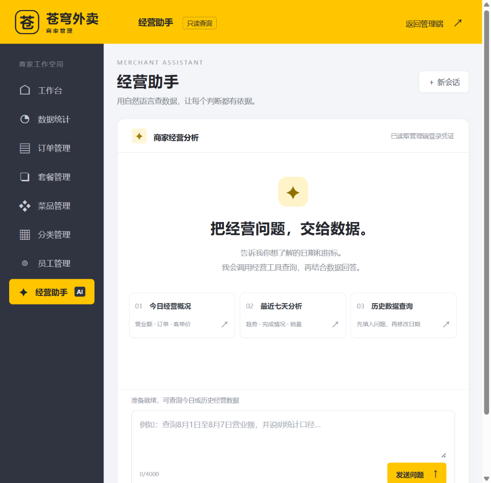
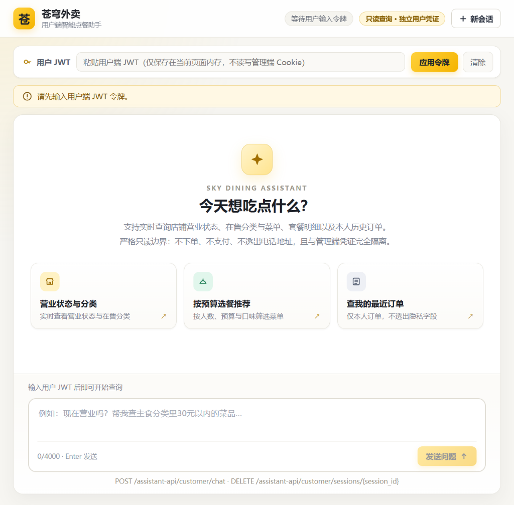
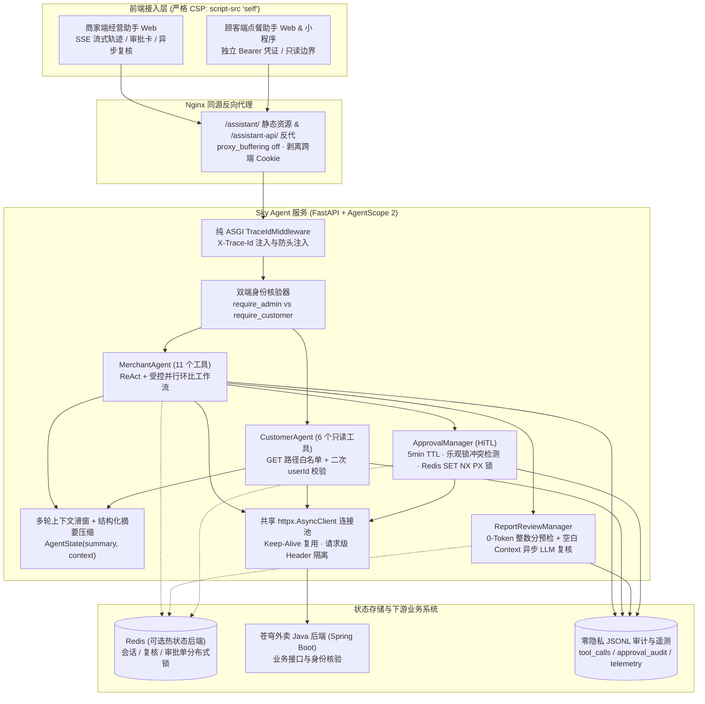
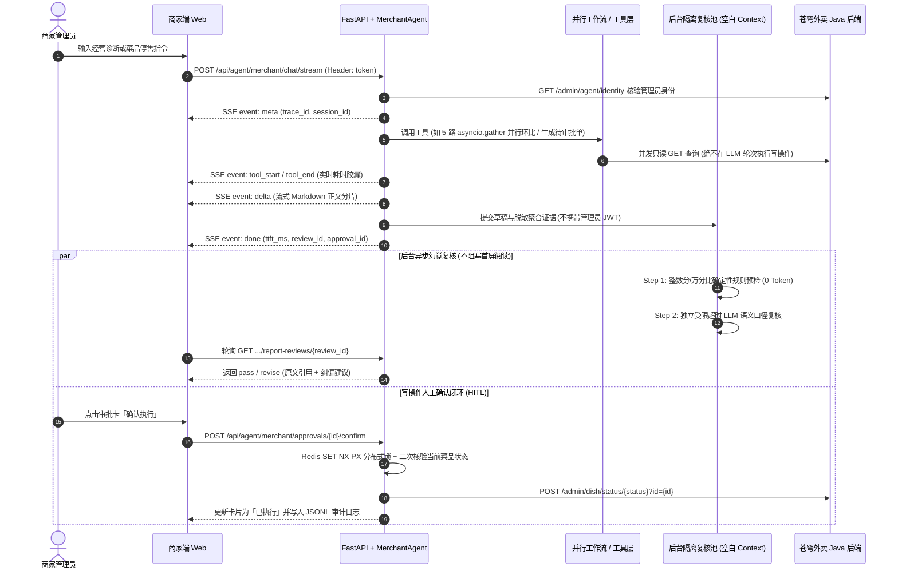

# DinePilot Agent — 餐饮双端生产级 AI Agent 服务

[](https://github.com/zak78805-art/dinepilot-agent/actions/workflows/ci.yml)
[](https://zak78805-art.github.io/dinepilot-agent/)
[](https://github.com/zak78805-art/skybite-delivery)

> 👉 **面试官免装环境直通车**：[**点此打开在线交互演示页（GitHub Pages）**](https://zak78805-art.github.io/dinepilot-agent/) — 直接在浏览器体验 **SSE 实时工具轨迹、5 路并行环比诊断、HITL 菜品停售审批确认、0-Token 幻觉预检纠偏、停止生成/重新生成、顾客隐私查单与脱敏遥测流**！
>
> 基于 **Python FastAPI + AgentScope 2 + 通义千问（百炼 OpenAI 兼容接口）+ Redis** 构建的「商家经营诊断 & 顾客智能点餐」双角色生产级 AI Agent 服务（配套 Java 业务后端：[skybite-delivery](https://github.com/zak78805-art/skybite-delivery)）。
> 聚焦真实生产落地中的核心工程问题：**双端零信任权限隔离、两阶段幻觉复核、Human-in-the-Loop 写操作审批与 Redis 分布式锁、受控并行工作流加速、SSE 流式控制与多轮滑窗压缩、按用户限流（429）与全链路 `trace_id` 可观测性**。

---

## 界面实拍预览

| 商家端 · 经营诊断助手（含管理端侧栏集成、SSE 执行轨迹、审批与异步复核） | 顾客端 · 智能点餐助手（独立用户 JWT 凭证、预算配餐、订单隐私脱敏） |
| --- | --- |
|  |  |

---

## 核心量化指标一览

| 维度 | 实测指标 | 验证方式 / 归档证据 |
| --- | --- | --- |
| **经营报告幻觉复核准确率** | 有效结论准确率 **100%（33/33）**，误报率 **0.0%**，漏报率 **0.0%** | 36 例 8 类基准集真机评测（[review-eval-36-live-qwen3.7-plus.json](docs/benchmarks/review-eval-36-live-qwen3.7-plus.json)） |
| **两阶段复核成本与超时优化** | 确定性规则 **0.031 ms / 0 Token** 拦截 **19.4%** 数值硬错误；超时率由 **35.7% 降至 8.3%** | `numeric_rules.py` 整数分/万分比预检 + 超时调优 A/B 对比 |
| **受控并行环比工作流加速** | 5 路后端聚合查询由串行 `604.9 ms` 降至 **`131.3 ms`**（**4.61× 加速**，延迟降低 **78.3%**） | 离线 I/O 基准压测（[parallel-workflow-bench.json](docs/benchmarks/parallel-workflow-bench.json)） |
| **自动化回归与安全红队覆盖** | Python **286 passed** · Node **58 passed** · Java 身份契约 **7 passed** · 密钥扫描 **0 泄漏** | 全离线零网络沙箱门禁（`tests/conftest.py` + `tools/secret_scan.py` + GitHub Actions CI） |

---

## 系统架构与时序设计

### 1. 整体分层架构



### 2. SSE 流式问答 + HITL 人工审批 + 异步幻觉复核时序



---

## 六大核心工程亮点

### 1. 双端零信任隔离与零 LLM 直接写库边界
- **认证隔离**：商家端通过 `/admin/agent/identity` 校验管理员 `token`；顾客端通过 `/user/agent/identity` 校验用户 `authentication`（Bearer），严禁前端自传 `role` 或 `user_id` 提权。
- **客户端与隐私投影隔离**：[CustomerBackendClient](app/clients/customer_backend_client.py) 采用严格正则 GET 路径白名单（显式拦截传统接口中用 GET 实现的催单等写副作用）；[customer_tools.py](app/tools/customer_tools.py) 强制核对返回记录 `userId == current_customer_id`，并自动剥离手机号、详细地址、收货人等敏感字段。
- **连接池零串号**：[http_pool.py](app/clients/http_pool.py) 在 FastAPI `lifespan` 中维护全局 `httpx.AsyncClient` Keep-Alive 连接池，实例本身不挂载任何默认鉴权头，每次请求从协程隔离的 `ContextVar` 动态注入。

### 2. 两阶段异步经营报告复核（0-Token 确定性预检 + 受限 LLM 复核）
- **痛点**：大模型在解读经营数据时容易出现「总订单为 0 却写完成率 0% 表现差」「把已完成订单营业额等同于净利润」「浮点加总偏差」等口径幻觉；若同步串行复核则会把首屏等待时间翻倍。
- **方案**：主回答流式输出后立即返回，后台由 [ReportReviewManager](app/review/manager.py) 在**空白 `contextvars.Context()`** 中启动异步复核（零管理员 Token 泄漏）：
  1. **Stage 1（[numeric_rules.py](app/review/numeric_rules.py)）**：采用精确整数分（`cents`）与万分比（`bps`）在 `0.031 ms`、**0 Token** 下拦截完成率、营业额、客单价、未完成单数、利润混用与空销量榜断言。
  2. **Stage 2（[llm_reviewer.py](app/review/llm_reviewer.py)）**：仅对通过数值预检的报告调用受限 `max_tokens` 与双层超时的复核模型，前端以只读 `textContent` 安全渲染纠偏徽章，绝不篡改原回答或执行模型 HTML。

#### 36 例 8 类基准集真机评测对比（通义千问 `qwen3.7-plus`）
| 评测阶段 | 样本规模 | 0-Token 规则拦截 | 有效结论准确率 | 误报 / 漏报 | 超时率 | 提示注入防御 |
| --- | ---: | ---: | ---: | ---: | ---: | ---: |
| Baseline（纯 LLM，`timeout=12.5s`） | 14 例 | 1 例（7.1%） | 9/9（100%） | 0% / 0% | 35.7%（5/14） | 通过 |
| **Optimized（增强整数预检 + `timeout=22s`）** | **36 例** | **7 例（19.4%）** | **33/33（100%）** | **0.0% / 0.0%** | **8.3%（3/36）** | **2/2 全拦截** |

### 3. Human-in-the-Loop（HITL）菜品上下架人工审批闭环
- 模型调用 `request_dish_status_change` 仅执行只读查询并在 [ApprovalManager](app/approval/manager.py) 生成 5 分钟 TTL 的 `pending` 审批票据，**LLM 推理循环内写库次数恒为 0**。
- 管理员点击前端审批卡片「确认执行」后，后端执行 **Redis `SET NX PX` + Lua 原子解锁**（防止多 Worker 并发重复提交）+ **最新菜品状态乐观校验**（若外部已改状态则返回 `409 Conflict`），通过后才调用 Java 写接口并落盘无 Token 的 `logs/approval_audit.jsonl`。

### 4. 受控并行经营诊断工作流（Planner → Parallel Executor → Exact Diff）
- 针对高频「本周对比上周 / 周期环比诊断」场景，[period_diagnosis.py](app/workflow/period_diagnosis.py) 将周期规划、**5 路 `asyncio.gather` 并发只读拉取**、整数分/万分比精确环比计算封装为单次受控工具 `get_period_comparison_report`。
- 上期对照接口异常时自动局部降级（`previous_available=False`），保障本期核心经营数据稳定可用，端到端 I/O 耗时压缩 **78.3%**（**4.61× 加速**）。

### 5. SSE 实时流式轨迹 & 多轮滑动窗口摘要压缩
- **SSE 流式协议**：`MerchantAgent.chat_stream` 实时推送 `meta`、`status`、`tool_start`、`tool_end(elapsed_ms)`、`delta`、`done(ttft_ms, total_ms)`，前端同步渲染胶囊式工具执行轨迹与无 HTML 安全 Markdown。
- **上下文压缩**：[context_compactor.py](app/memory/context_compactor.py) 对接 AgentScope 2 `AgentState`，超阈值时按完整 `user` 轮次边界切分，剥离早期轮次大体积工具原始 JSON，生成有界防旧数污染摘要，支持通过 [RedisStateStore](app/storage/redis_store.py) 跨 Worker 持久化恢复。

### 6. 全链路 `trace_id` 可观测性与零隐私 FinOps 报表
- 纯 ASGI [TraceIdMiddleware](app/observability/context.py) 无缓冲贯穿 HTTP/SSE 响应头、工具审计日志、轮次遥测与后台隔离复核。
- [telemetry_report.py](tools/telemetry_report.py) 一键从脱敏 JSONL 聚合输出分角色 **TTFT P50/P95**、**总耗时 P50/P95**、**Token 均值/P95**、复核预检命中率与审批转化漏斗。

---

## 核心代码地图

| 模块路径 | 职责说明 |
| --- | --- |
| [app/main.py](app/main.py) / [app/api/routes.py](app/api/routes.py) | FastAPI 生命周期连接池管理、纯 ASGI `TraceIdMiddleware`、双端 REST & SSE 路由 |
| [app/agent/merchant_agent.py](app/agent/merchant_agent.py) / [customer_agent.py](app/agent/customer_agent.py) | 商家端（11 工具）与顾客端（6 工具）Agent 编排、流式事件输出与会话清理 |
| [app/workflow/period_diagnosis.py](app/workflow/period_diagnosis.py) | 受控并行环比诊断工作流（Planner → `asyncio.gather` 5 路扇出 → 精确整数分环比） |
| [app/review/numeric_rules.py](app/review/numeric_rules.py) / [manager.py](app/review/manager.py) | 0-Token 整数分/万分比确定性预检规则、空白 `Context` 有界异步复核池 |
| [app/approval/manager.py](app/approval/manager.py) / [audit_log.py](app/approval/audit_log.py) | HITL 人工审批状态机、TTL 过期、乐观冲突校验、Redis 分布式锁与 JSONL 审计 |
| [app/memory/session_store.py](app/memory/session_store.py) / [context_compactor.py](app/memory/context_compactor.py) | 有界会话管理、多轮滑动窗口与结构化摘要压缩 |
| [app/storage/redis_store.py](app/storage/redis_store.py) / [app/clients/http_pool.py](app/clients/http_pool.py) | 可选 Redis 跨进程状态持久化（`SET NX PX` + Lua）与共享 HTTP 连接池 |
| [app/security/rate_limit.py](app/security/rate_limit.py) | 按 `(role, user_id)` 滑动窗口 RPM 限流与自然日 Token 配额熔断（HTTP 429 + `Retry-After`） |
| [app/observability/telemetry.py](app/observability/telemetry.py) / [tools/telemetry_report.py](tools/telemetry_report.py) | 零隐私结构化遥测采集与 P50/P95 延迟 / Token FinOps 统计 CLI |
| [Dockerfile](Dockerfile) / [docker-compose.yml](docker-compose.yml) / [.github/workflows/ci.yml](.github/workflows/ci.yml) | 非 root 容器镜像、Redis 编排一键启动与 GitHub Actions 自动化离线门禁 |
| [docs/index.html](docs/index.html) / [web/index.html](web/index.html) / [web/core.mjs](web/core.mjs) | GitHub Pages 零后端交互演示页 + 商家端（含停止生成/复制/重试）与顾客端原生前端 |
| [tests/test_day11_security_matrix.py](tests/test_day11_security_matrix.py) | 纵向跨角色越权、横向管理员隔离、头注入与 Prompt Injection 安全红队回归 |

---

## 快速验证（无需 API Key、无需启动外部服务）

仓库内置离线网络门禁（`tests/conftest.py` 自动阻断任何真实外部 TCP / DNS 请求），克隆后可一键跑通全套测试与基准：

```bash
# 1. 创建虚拟环境并安装依赖
python -m venv .venv
# Windows: .\.venv\Scripts\activate   |   macOS/Linux: source .venv/bin/activate
pip install -r requirements.txt

# 2. 运行 Python 全量单元测试与安全攻防矩阵（286 条用例，0 模型调用）
python -B -m pytest tests -q

# 3. 运行前端核心与双端交互测试（Node 18+）
node --test tests/web/core.test.mjs tests/web/customer-web.test.cjs tests/web/customer-live.test.mjs

# 4. 运行 36 例幻觉复核离线基准 + 并行工作流延迟基准 + 遥测 P50/P95 汇总 + 密钥扫描
python -B -m tools.report_review_eval --mode offline
python -B -m tools.parallel_workflow_bench
python -B -m tools.telemetry_report --synthetic-demo
python -B tools/secret_scan.py

# 可选：Docker Compose 一键启动 Agent + Redis
docker compose up --build
```

---

## 本地全栈联调启动（对接苍穹外卖 Java + MySQL + Redis + Nginx）

1. 复制环境变量模板并填入百炼 API Key（`.env` 已被 `.gitignore` 严格排除）：
   ```bash
   cp .env.example .env
   ```
2. 启动苍穹外卖 Java 后端（端口 `8080`）与可选 Redis（`STATE_STORE_MODE=redis` 时启用跨进程持久化）：
   ```bash
   uvicorn app.main:app --host 127.0.0.1 --port 8090
   ```
3. 通过 Nginx 加载 [deploy/nginx-assistant.conf](deploy/nginx-assistant.conf) 后访问：
   - **商家端经营助手**：`http://localhost/assistant/`（先在 `http://localhost/` 登录管理端获取同源 `token`）
   - **顾客端实时点餐助手**：`http://localhost/assistant/customer/live.html`（粘贴用户端 JWT 即可对话，不读取商家端 Cookie）
   - **顾客端免后端离线体验页**：直接用浏览器打开 `web/customer/index.html`

更多专题设计说明详见 [docs/dual-agent-api.md](docs/dual-agent-api.md)、[docs/audit-safety.md](docs/audit-safety.md) 与 [docs/session-management.md](docs/session-management.md)。
